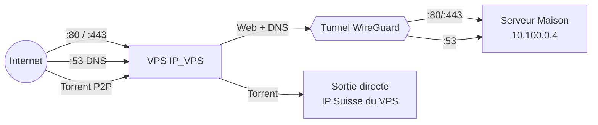

# 🌐 Configuration du VPS — Passerelle WireGuard

> Guide de configuration d'un VPS (Infomaniak ou autre) comme passerelle WireGuard
> pour rediriger le trafic vers un serveur multimédia maison.

---

## 📋 Table des matières

1. [Prérequis](#1--prérequis)
2. [Installation de WireGuard](#2--installation-de-wireguard)
3. [Génération des clés](#3--génération-des-clés)
4. [Configuration de WireGuard (`wg0.conf`)](#4--configuration-de-wireguard-wg0conf)
5. [Activation du forwarding IP](#5--activation-du-forwarding-ip)
6. [Règles iptables — Split Tunneling](#6--règles-iptables--split-tunneling)
7. [Démarrage automatique](#7--démarrage-automatique)
8. [Sécurisation du VPS](#8--sécurisation-du-vps)
9. [Vérification](#9--vérification)

---

## 🔑 Informations clés

| Paramètre                     | Valeur                |
|-------------------------------|-----------------------|
| IP publique du VPS            | `IP_VPS`              |
| Interface réseau VPS          | `ens3` *(à adapter)*  |
| IP WireGuard du VPS           | `10.100.0.1/24`       |
| IP WireGuard Gluetun (maison) | `10.100.0.2`          |
| IP WireGuard serveur (maison) | `10.100.0.4`          |
| Port WireGuard                | `51820/udp`           |

### 🔀 Principe du Split Tunneling



| Type de trafic       | Destination                          | IP de sortie       |
|----------------------|--------------------------------------|--------------------|
| 🌍 Web (80, 443)    | → Serveur maison (`10.100.0.4`)      | IP maison          |
| 📡 DNS (53)         | → Serveur maison (`10.100.0.4`)      | IP maison          |
| 📥 Torrent (P2P)    | → Reste sur le VPS                   | IP Suisse (VPS)    |

---

## 1. 📦 Prérequis

Avant de commencer, assurez-vous d'avoir :

- ✅ Un VPS sous **Ubuntu 22.04+** ou **Debian 12+**
- ✅ Un accès **root** (ou un utilisateur avec `sudo`)
- ✅ Une IP publique fixe sur le VPS
- ✅ Un accès SSH fonctionnel

> [!NOTE]
> Ce guide utilise l'interface `ens3` comme interface réseau principale du VPS (standard chez Infomaniak).
> Si votre fournisseur utilise `eth0` ou une autre interface, adaptez les commandes en conséquence.
> Vérifiez votre interface avec : `ip addr show`

1. Connectez-vous à votre VPS en SSH :

```bash
ssh root@IP_VPS
```

2. Mettez à jour le système :

```bash
apt update && apt upgrade -y
```

---

## 2. 🛠️ Installation de WireGuard

1. Installez WireGuard et les outils nécessaires :

```bash
apt update && apt install wireguard
```

2. Installez également `iptables-persistent` pour sauvegarder les règles firewall :

```bash
apt install iptables-persistent netfilter-persistent -y
```

3. Vérifiez que WireGuard est bien installé :

```bash
wg --version
```

> [!TIP]
> Si vous utilisez un noyau ancien (< 5.6), il faudra peut-être installer le module noyau séparément.
> Sur Ubuntu 22.04+ et Debian 12+, WireGuard est intégré au noyau par défaut.

---

## 3. 🔐 Génération des clés

1. Générez la paire de clés du VPS :

```bash
wg genkey | tee /etc/wireguard/privatekey | wg pubkey > /etc/wireguard/publickey
```

2. Sécurisez les fichiers de clés :

```bash
chmod 600 /etc/wireguard/privatekey
chmod 644 /etc/wireguard/publickey
```

3. Notez les clés générées (vous en aurez besoin pour la configuration) :

```bash
echo "🔒 Clé privée VPS : $(cat /etc/wireguard/privatekey)"
echo "🔑 Clé publique VPS : $(cat /etc/wireguard/publickey)"
```

> [!IMPORTANT]
> La **clé privée** ne doit **jamais** être partagée ni exposée.
> La **clé publique** sera communiquée aux peers (serveur maison, Gluetun).

4. Notez également les clés publiques de vos peers côté maison :
   - La clé publique du conteneur **Gluetun** (générée lors de sa configuration)
   - La clé publique du **serveur maison** (interface WireGuard du host)

---

## 4. ⚙️ Configuration de WireGuard (`wg0.conf`)

1. Créez le fichier de configuration WireGuard :

```bash
nano /etc/wireguard/wg0.conf
```

2. Collez la configuration suivante :

```ini
[Interface]
Address = 10.100.0.1/24
ListenPort = 51820
PrivateKey = <CLÉ_PRIVÉE_VPS>

# ──────────────────────────────────────────────
# Peer 1 : Gluetun (container Docker sur serveur maison)
# Utilisé pour le trafic torrent (sortie P2P via le VPS)
# ──────────────────────────────────────────────
[Peer]
PublicKey = <CLÉ_PUBLIQUE_GLUETUN>
AllowedIPs = 10.100.0.2/32

# ──────────────────────────────────────────────
# Peer 2 : Serveur maison (trafic web direct)
# Reçoit le trafic web (80/443) et DNS (53) redirigé
# ──────────────────────────────────────────────
[Peer]
PublicKey = <CLÉ_PUBLIQUE_SERVEUR>
AllowedIPs = 10.100.0.4/32
```

> [!WARNING]
> Remplacez les placeholders par vos vraies clés :
> - `<CLÉ_PRIVÉE_VPS>` → contenu de `/etc/wireguard/privatekey`
> - `<CLÉ_PUBLIQUE_GLUETUN>` → clé publique générée par le conteneur Gluetun
> - `<CLÉ_PUBLIQUE_SERVEUR>` → clé publique de l'interface WireGuard du serveur maison

3. Protégez le fichier de configuration :

```bash
chmod 600 /etc/wireguard/wg0.conf
```

### 📝 Explication des peers

| Peer     | IP WireGuard  | Rôle                                                         |
|----------|---------------|--------------------------------------------------------------|
| Gluetun  | `10.100.0.2`  | Conteneur Docker — le trafic torrent sort via le VPS         |
| Serveur  | `10.100.0.4`  | Host du serveur maison — reçoit le web (Traefik) et DNS (AdGuard) |

---

## 5. 🔄 Activation du forwarding IP

Le forwarding IP est indispensable pour que le VPS puisse relayer le trafic entre ses interfaces.

1. Activez le forwarding de manière permanente :

```bash
echo 'net.ipv4.ip_forward=1' >> /etc/sysctl.conf
```

2. Appliquez le changement immédiatement :

```bash
sysctl -p
```

3. Vérifiez que le forwarding est bien actif :

```bash
cat /proc/sys/net/ipv4/ip_forward
```

> Le résultat doit être `1`.

---

## 6. 🔥 Règles iptables — Split Tunneling

C'est le cœur de la configuration : les règles iptables définissent quel trafic est redirigé vers le serveur maison et quel trafic reste sur le VPS.

### 🔀 Résumé des règles

| Règle                         | Action                                                    |
|-------------------------------|-----------------------------------------------------------|
| TCP `:80` entrant sur `ens3`  | DNAT → `10.100.0.4:80` (Traefik / serveur maison)        |
| TCP `:443` entrant sur `ens3` | DNAT → `10.100.0.4:443` (Traefik / serveur maison)       |
| UDP `:53` entrant sur `ens3`  | DNAT → `10.100.0.4:53` (AdGuard Home / serveur maison)   |
| TCP `:53` entrant sur `ens3`  | DNAT → `10.100.0.4:53` (AdGuard Home / serveur maison)   |
| Trafic sortant sur `ens3`     | MASQUERADE (NAT sortant pour le trafic P2P/torrent)       |

### 📜 Script complet : `vps-firewall.sh`

1. Le script se trouve dans `scripts/vps-firewall.sh`. Voici son contenu complet :

```bash
#!/bin/bash
# Configuration Firewall VPS (Gateway)
# Split Tunneling Sécurisé :
# - Web/DNS -> Redirigé vers Serveur Maison (10.100.0.4)
# - Torrent -> Reste sur le VPS/VPN (Sortie Suisse/Autre)

# Interface WAN (A adapter si différent, ex: eth0)
WAN_IFACE="ens3"

# IP du serveur AdGuard/Traefik via le VPN
HOME_SERVER_IP="10.100.0.4"
# IP du conteneur Gluetun (Torrent)
GLUETUN_IP="10.100.0.2"

echo "Nettoyage des anciennes regles..."
sudo iptables -t nat -D PREROUTING -p tcp --dport 80 -j DNAT --to-destination $GLUETUN_IP:80 2>/dev/null
sudo iptables -t nat -D PREROUTING -p tcp --dport 443 -j DNAT --to-destination $GLUETUN_IP:443 2>/dev/null
sudo iptables -t nat -D PREROUTING -p udp --dport 53 -j DNAT --to-destination $HOME_SERVER_IP:53 2>/dev/null
sudo iptables -t nat -D PREROUTING -p tcp --dport 53 -j DNAT --to-destination $HOME_SERVER_IP:53 2>/dev/null

echo "Application des nouvelles regles sur $WAN_IFACE..."
# Redirection Web (80/443) vers AdGuard/Traefik
sudo iptables -t nat -A PREROUTING -i $WAN_IFACE -p tcp --dport 80 -j DNAT --to-destination $HOME_SERVER_IP:80
sudo iptables -t nat -A PREROUTING -i $WAN_IFACE -p tcp --dport 443 -j DNAT --to-destination $HOME_SERVER_IP:443

# Redirection DNS (53) vers AdGuard
sudo iptables -t nat -A PREROUTING -i $WAN_IFACE -p udp --dport 53 -j DNAT --to-destination $HOME_SERVER_IP:53
sudo iptables -t nat -A PREROUTING -i $WAN_IFACE -p tcp --dport 53 -j DNAT --to-destination $HOME_SERVER_IP:53

# Masquerade (NAT sortant)
sudo iptables -t nat -A POSTROUTING -o $WAN_IFACE -j MASQUERADE

echo "Sauvegarde..."
sudo netfilter-persistent save
echo "Terminé !"
```

2. Copiez ce script sur le VPS et rendez-le exécutable :

```bash
chmod +x /opt/scripts/vps-firewall.sh
```

3. Exécutez le script :

```bash
/opt/scripts/vps-firewall.sh
```

4. Vérifiez que les règles sont bien appliquées :

```bash
sudo iptables -t nat -L -n -v
```

> [!TIP]
> Si vous modifiez l'interface réseau (ex : `eth0` au lieu de `ens3`), éditez la variable
> `WAN_IFACE` en haut du script **avant** de l'exécuter.

### 🧠 Comprendre le flux

```
Client Internet
    │
    ▼
┌──────────────────────────────┐
│  VPS (IP_VPS)                │
│  Interface : ens3            │
│                              │
│  :80/:443 entrant ?          │
│    → DNAT vers 10.100.0.4    │──── Tunnel WG ────→ Serveur Maison (Traefik)
│                              │
│  :53 entrant ?               │
│    → DNAT vers 10.100.0.4    │──── Tunnel WG ────→ Serveur Maison (AdGuard)
│                              │
│  Trafic torrent ?            │
│    → MASQUERADE → Internet   │──── Sortie IP Suisse
└──────────────────────────────┘
```

---

## 7. 🚀 Démarrage automatique

1. Activez le service WireGuard au démarrage :

```bash
systemctl enable wg-quick@wg0
```

2. Démarrez l'interface WireGuard maintenant :

```bash
systemctl start wg-quick@wg0
```

3. Vérifiez le statut du service :

```bash
systemctl status wg-quick@wg0
```

> [!NOTE]
> Si vous modifiez `wg0.conf`, redémarrez l'interface avec :
> ```bash
> systemctl restart wg-quick@wg0
> ```

---

## 8. 🛡️ Sécurisation du VPS

### 8.1 — Configuration de UFW (Uncomplicated Firewall)

1. Installez UFW si nécessaire :

```bash
apt install ufw -y
```

2. Configurez les règles de base :

```bash
# Autoriser SSH (indispensable, sinon vous perdez l'accès !)
ufw allow ssh

# Autoriser WireGuard
ufw allow 51820/udp

# Autoriser le trafic web entrant (redirigé vers le serveur maison)
ufw allow 80/tcp
ufw allow 443/tcp

# Autoriser le DNS entrant (redirigé vers le serveur maison)
ufw allow 53/udp
ufw allow 53/tcp
```

3. Activez UFW :

```bash
ufw enable
```

> [!CAUTION]
> **Vérifiez bien** que la règle SSH est active **AVANT** d'activer UFW.
> Sinon, vous risquez de perdre définitivement l'accès à votre VPS !

4. Vérifiez les règles actives :

```bash
ufw status verbose
```

### 8.2 — Installation de Fail2ban

Fail2ban protège contre les attaques par brute-force sur SSH.

1. Installez Fail2ban :

```bash
apt install fail2ban -y
```

2. Créez un fichier de configuration local :

```bash
cp /etc/fail2ban/jail.conf /etc/fail2ban/jail.local
nano /etc/fail2ban/jail.local
```

3. Modifiez la section `[sshd]` pour l'activer et whitelister votre IP maison :

```ini
[DEFAULT]
# Whitelister l'IP de la maison pour ne jamais se bloquer soi-même
ignoreip = 127.0.0.1/8 ::1 IP_PUBLIQUE_BOX

[sshd]
enabled = true
port = ssh
filter = sshd
logpath = /var/log/auth.log
maxretry = 5
findtime = 600
bantime = 3600
```

> [!NOTE]
> - `ignoreip` : l'IP `IP_PUBLIQUE_BOX` est l'IP publique de votre connexion maison — elle ne sera jamais bannie
> - `maxretry = 5` : 5 tentatives échouées avant bannissement
> - `findtime = 600` : fenêtre de 10 minutes pour les tentatives
> - `bantime = 3600` : bannissement de 1 heure

4. Redémarrez Fail2ban :

```bash
systemctl restart fail2ban
systemctl enable fail2ban
```

5. Vérifiez que Fail2ban fonctionne :

```bash
fail2ban-client status sshd
```

### 8.3 — Whitelist de l'IP maison (résumé)

| Service    | IP whitelistée   | Raison                                      |
|------------|------------------|---------------------------------------------|
| Fail2ban   | `IP_PUBLIQUE_BOX`   | Éviter de se bloquer soi-même en SSH        |
| UFW        | (toutes les IP)  | Ports 80/443/53 ouverts publiquement        |

> [!TIP]
> Si votre IP maison change régulièrement, envisagez d'utiliser un service de DNS dynamique
> (ex : DuckDNS) et un script cron qui met à jour la whitelist Fail2ban automatiquement.

---

## 9. ✅ Vérification

Une fois tout configuré, effectuez ces tests dans l'ordre :

### 9.1 — Vérifier l'état de WireGuard

1. Affichez l'état des peers :

```bash
wg show
```

Vous devriez voir vos deux peers avec leurs clés publiques :

```
interface: wg0
  public key: <CLÉ_PUBLIQUE_VPS>
  private key: (hidden)
  listening port: 51820

peer: <CLÉ_PUBLIQUE_GLUETUN>
  allowed ips: 10.100.0.2/32
  latest handshake: X seconds ago
  transfer: X.XX MiB received, X.XX MiB sent

peer: <CLÉ_PUBLIQUE_SERVEUR>
  allowed ips: 10.100.0.4/32
  latest handshake: X seconds ago
  transfer: X.XX MiB received, X.XX MiB sent
```

> [!IMPORTANT]
> Si `latest handshake` n'apparaît pas pour un peer, cela signifie que la connexion
> n'a pas encore été établie depuis ce peer. Le handshake se fait à l'initiative du client
> (serveur maison), pas du serveur WireGuard (VPS).

### 9.2 — Tester le tunnel vers Gluetun

2. Pingez le conteneur Gluetun via le tunnel :

```bash
ping -c 4 10.100.0.2
```

Résultat attendu :
```
PING 10.100.0.2 (10.100.0.2) 56(84) bytes of data.
64 bytes from 10.100.0.2: icmp_seq=1 ttl=64 time=XX.X ms
```

### 9.3 — Tester le tunnel vers le serveur maison

3. Pingez le serveur maison directement :

```bash
ping -c 4 10.100.0.4
```

Résultat attendu :
```
PING 10.100.0.4 (10.100.0.4) 56(84) bytes of data.
64 bytes from 10.100.0.4: icmp_seq=1 ttl=64 time=XX.X ms
```

### 9.4 — Tester la redirection web

4. Depuis un ordinateur externe (pas le VPS, pas le serveur maison), testez :

```bash
curl -I http://IP_VPS
```

> Si Traefik est configuré côté maison, vous devriez recevoir une réponse HTTP du serveur maison.

### 9.5 — Checklist finale

| Test                                | Commande                   | ✅ Attendu                           |
|-------------------------------------|----------------------------|--------------------------------------|
| WireGuard actif                     | `wg show`                  | Peers visibles avec handshake        |
| Tunnel vers Gluetun                 | `ping 10.100.0.2`          | Réponse en < 50 ms                   |
| Tunnel vers serveur maison          | `ping 10.100.0.4`          | Réponse en < 50 ms                   |
| IP forwarding actif                 | `cat /proc/sys/net/ipv4/ip_forward` | `1`                          |
| Règles iptables présentes           | `iptables -t nat -L -n`    | Règles DNAT et MASQUERADE visibles   |
| Fail2ban actif                      | `fail2ban-client status`   | Jail `sshd` active                   |
| UFW actif                           | `ufw status`               | Ports 22, 51820, 80, 443, 53 ouverts |

---

## 🆘 Dépannage

| Problème                                   | Solution                                                             |
|--------------------------------------------|----------------------------------------------------------------------|
| Pas de handshake WireGuard                 | Vérifier que le port 51820/UDP est ouvert côté VPS **et** box maison |
| Ping échoue vers `10.100.0.x`             | Vérifier `ip_forward=1` et que `wg0` est UP (`wg show`)             |
| Web ne passe pas malgré tunnel OK          | Vérifier les règles iptables : `iptables -t nat -L -n -v`           |
| Bloqué hors du VPS après `ufw enable`     | Accéder via la console web du fournisseur (Infomaniak, etc.)         |
| Fail2ban a banni votre IP                  | Console web → `fail2ban-client unban IP_MAISON`                     |

---

> [!NOTE]
> 📄 Ce guide fait partie de la documentation du projet **Jellyfin Stack**.
> Pour la suite, consultez le guide de configuration du serveur maison.
